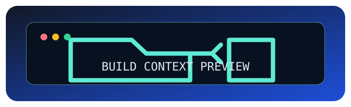

<p align="center"></p>
<p align="center"></p>
<p align="center">   </p>
<p align="center"></p>

## 🧭 Overview
Docker Context Report walks a local build directory and estimates which files are included after applying common `.dockerignore` patterns. It is a read-only preview and clearly labels its matching rules as an approximation.

## ✨ Features
- 📦 Count included files and estimate total bytes
- 🚫 Apply common glob, directory, and negation rules from `.dockerignore`
- 📊 Show the largest files likely to enter the build context
- 🔒 Never builds an image or changes the source directory

## 🖥️ Demo
No hosted demo is provided. Run the project locally using the quick-start command.

## 🚀 Quick Start
Requires Python 3.10 or newer.

```bash
python main.py ./app
```

Run checks with `python -m unittest discover -s tests -v`.

## 🧰 Tech Stack
- Python standard library
- `argparse` CLI and `unittest`
- Read-only inspection by default

## 🗂️ Folder Structure
```text
.
├── .github/workflows/ci.yml
├── assets/mark.svg
├── tests/test_main.py
├── main.py
├── pyproject.toml
└── README.md
```

## 🗺️ Roadmap
- [ ] Add more edge-case fixtures
- [ ] Improve machine-readable output
- [ ] Keep the core workflow lightweight and local-first

## 🤝 Contributing
Issues and focused pull requests are welcome. Add regression tests for parser and reporting changes.

## 📄 License
MIT License. See [LICENSE](LICENSE).
<p align="center"></p>
